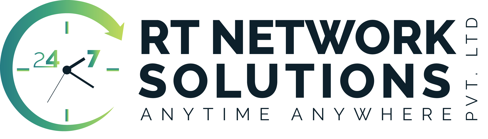
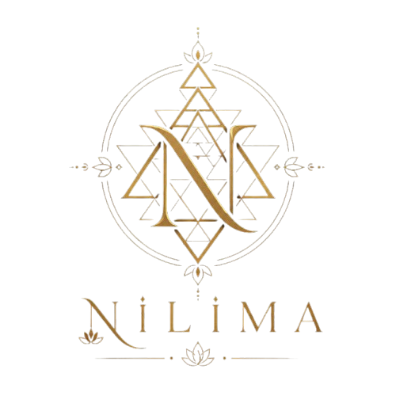
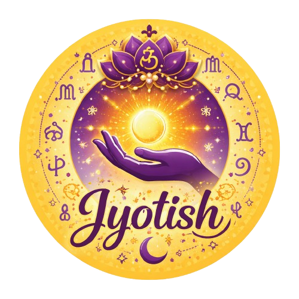
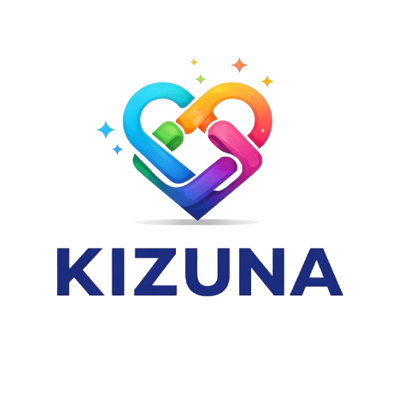
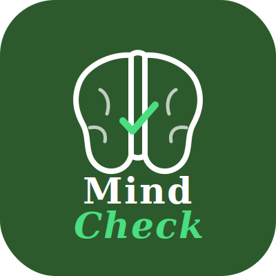

# Hi 👋, I'm Nilima Kumar

### Full Stack Developer • AI Enthusiast 

---

## 🌐 Connect With Me

  

  

  

---

# 👨‍💻 About Me

I'm **Nilima Kumar**, a passionate **Full Stack Developer** and **Computer Science & Engineering student** from Kolkata, India.

I enjoy building scalable web applications, AI-powered solutions, and user-centric digital experiences using modern technologies.

### 🚀 Currently

- 💻 Building Full Stack Web Applications
- 🤖 Exploring Generative AI & RAG Systems
- 🌱 Learning Advanced AI Engineering
- ⚡ Passionate about SEO, Performance & Modern UI
- 🎯 Open to Software Development Opportunities

# 💻 Tech Stack

### 🌐 Frontend

  

### ⚙️ Backend

  

### 🤖 AI & Programming

  

- Generative AI
- Retrieval-Augmented Generation (RAG)
- Gemini API Integration
- Prompt Engineering

### 🗄️ Database

  

### 🛠️ DevOps & Tools

  

### ☁️ Platforms & Productivity

- Vercel
- Netlify
- Notion

# 💼 Professional Experience

<table>
<tr>
<td width="70" align="center">

</td>
<td>

### Campus Ambassador • IIT Bombay
**June 2026 – Present**

- Contributing to event management and technical initiatives.
- Assisting in web development for institute activities.
- Supporting marketing campaigns and student outreach.
- Collaborating with cross-functional teams to ensure successful event execution.

</td>
</tr>

<tr>
<td width="70" align="center">

</td>
<td>

### Campus Ambassador • IIT Delhi (Tryst'26)
**February 2026 – May 2026**

- Represented Tryst'26, IIT Delhi's annual technical festival.
- Led campus outreach and promoted technical events.
- Strengthened leadership, communication, and networking skills.

</td>
</tr>

<tr>
<td width="70" align="center">

</td>
<td>

### AI/ML Intern • Google for Developers × Eduskills Foundation
**January 2026 – March 2026**

- Gained hands-on experience in Artificial Intelligence and Machine Learning.
- Worked on real-world AI concepts, data preprocessing, and model development.
- Improved problem-solving through project-based learning.

</td>
</tr>

<tr>
<td width="70" align="center">

</td>
<td>

### AI Data Annotator • RT Network Solutions
**January 2026 – April 2026**

- Annotated and validated datasets for AI model training.
- Maintained high-quality data standards across annotation workflows.
- Collaborated with AI teams to improve model accuracy.

</td>
</tr>

<tr>
<td width="70" align="center">

</td>
<td>

### Nuxt Developer • Red Cat Pictures
**September 2025 – January 2026**

- Built modern web applications using Nuxt.js, Vue.js, and TypeScript.
- Developed a Retrieval-Augmented Generation (RAG) AI assistant.
- Integrated Google Gemini API with Notion as a dynamic knowledge base.
- Focused on scalable architecture and application performance.

</td>
</tr>
</table>

# 🚀 Featured Projects

<table>
<tr>
<td width="70" align="center">

</td>
<td>

### Personal Portfolio

A modern portfolio built with **Nuxt 4** to showcase my projects, professional experience, and technical expertise while maintaining strong SEO, performance, and accessibility standards.

**Highlights**
- Responsive UI
- Advanced SEO (JSON-LD, Sitemap & Robots.txt)
- Google Search Console Integration
- Performance Optimized
- Recruiter-friendly Design

**Tech Stack**

`Nuxt.js` `Vue.js` `TypeScript` `Tailwind CSS`

🌐 **Live Demo:** https://nilima-kumar.vercel.app

💻 **Repository:** https://github.com/kumarnilima1512-bit/Nilima-Kumar

</td>
</tr>
</table>
---

<table>
<tr>
<td width="70" align="center">

</td>
<td>

### WebInfo — Website Health Checker

A modern web auditing tool that analyzes SEO and technical health metrics to generate comprehensive website reports.

**Highlights**
- HTTP Status Checker
- Response Time Analysis
- Meta Tag Analysis
- Heading Structure Detection
- Image Alt Analysis
- Internal & External Link Detection
- SEO Health Report

**Tech Stack**

`Nuxt.js` `Vue.js` `TypeScript` 

🌐 **Live Demo:** https://web-info-sage.vercel.app

💻 **Repository:** https://github.com/kumarnilima1512-bit/WebInfo

</td>
</tr>
</table>
---

<table>
<tr>
<td width="70" align="center">

</td>
<td>

###  RAG AI Agent

An AI-powered Retrieval-Augmented Generation (RAG) assistant developed during my time at **Red Cat Pictures** to provide context-aware responses using organizational knowledge.

**Highlights**
- RAG Architecture
- Google Gemini API Integration
- Notion Knowledge Base
- Context-Aware AI Responses
- Prompt Engineering

**Tech Stack**

`Nuxt.js` `Vue.js` `TypeScript` `Gemini API` `Notion API`

💻 **Repository:** https://github.com/kumarnilima1512-bit/RED-CAT-CHATBOT

</td>
</tr>
</table>
---

<table>
<tr>
<td width="70" align="center">

</td>
<td>

### Gold Fish Talents

A networking platform for creative professionals to showcase portfolios, connect with collaborators, and discover career opportunities.

**Highlights**
- Portfolio Management
- Professional Networking
- Responsive User Interface
- Scalable Frontend Architecture

**Tech Stack**

`Nuxt.js` `Vue.js` `TypeScript`

🌐 **Live Demo:** https://goldfishtalents.com

💻 **Repository:** https://github.com/Gold-Fish-Talents/gold-fish-talents

</td>
</tr>
</table>

---

<table>
<tr>
<td width="70" align="center">

</td>
<td>

### Jyotish AI

An AI-powered astrology platform offering personalized insights through Vedic Astrology, Tarot Reading, Numerology, Panchang, and Horoscope predictions.

**Highlights**
- AI-powered personalized readings
- Tarot & Numerology modules
- Panchang & Horoscope support
- Gemini API integration
- Notion-powered knowledge base

**Tech Stack**

`Nuxt.js` `Vue.js` `TypeScript` `Gemini API` `Notion API`

</td>
</tr>
</table>

---

<table>
<tr>
<td width="70" align="center">

</td>
<td>

### Kizuna — Logic Puzzle Game

A browser-based logic puzzle game inspired by LinkedIn's Zip challenge, where players connect numbered nodes in sequence to complete the entire grid without leaving any cell unvisited.

**Highlights**
- Number-sequence pathfinding gameplay
- Interactive grid-based mechanics
- Responsive game interface
- Score and game-state management
- Optimized user experience across devices

**Tech Stack**

`React.js` `JavaScript` `CSS` `Docker`

🌐 **Live Demo:** https://kizuna-the-zip-game.vercel.app

💻 **Repository:** https://github.com/kumarnilima1512-bit/Kizuna-the-zip-game

</td>
</tr>
</table>

---

<table>
<tr>
<td width="70" align="center">

</td>
<td>

### MindCheck

A mental wellness web application designed to help users assess their emotional well-being through interactive self-assessment questionnaires while providing a simple, accessible, and user-friendly experience.

**Highlights**
- Interactive mental health assessment
- User-friendly and responsive interface
- Instant assessment results
- Privacy-focused experience
- Clean and accessible design

**Tech Stack**

`Nuxt.js` `Vue.js` `TypeScript` `Tailwind CSS`

🌐 **Live Demo:** https://mind-check-seven.vercel.app

💻 **Repository:** https://github.com/kumarnilima1512-bit/MindCheck

</td>
</tr>
</table>

# 🌱 Currently Exploring

- 🤖 AI Agents & Agentic Workflows
- 🧠 Advanced Retrieval-Augmented Generation (RAG)
- ⚡ Scalable Full Stack Architecture
- 🏗️ System Design & Software Architecture
- 🚀 Performance Optimization & Technical SEO
- ☁️ Cloud Deployment & DevOps Best Practices

# 🏆 Achievements

- 🥇 **State Karate Gold Medalist** – Represented my state in Karate and secured a Gold Medal.

- 🥉 **National Karate Bronze Medalist** – Represented my state at the national level and secured a Bronze Medal.

- 🎓 **Campus Ambassador** – Represented **IIT Delhi (Tryst'26)** and **IIT Bombay**, promoting technical events, innovation, and student engagement.

- 💼 **Industry Experience** – Built AI-powered web applications and contributed to modern full-stack development across professional environments.

- 🚀 **Open Source & Personal Projects** – Designed and developed multiple full-stack, AI-powered, and SEO-focused applications using modern web technologies.

# 📊 GitHub Analytics

# 🏆 GitHub Trophies

# 📈 Contribution Graph

# 🌸 Beyond Coding

Outside of software development, I enjoy exploring creativity through various art forms and activities that help me stay disciplined, inspired, and continuously learning.

- 💃 Trained in **Rabindra Nritya, Bharatanatyam, Creative, and Bollywood Dance**
- 🎹 Enjoy playing the **Piano (Walk Band)** and **Harmonium**
- 🎨 Passionate about creating **Mandala Art**
- ✍️ Love writing **Poetry**
- 🥋 Former **State Karate Gold Medalist** & **National Karate Bronze Medalist**

# 🤝 Let's Build Something Amazing Together

If you enjoy my work or would like to collaborate on exciting projects, feel free to connect with me.

⭐ Don't forget to explore my repositories and leave a star if you find something useful!

### Thanks for visiting my profile! 💙

*"Building modern web applications with creativity, discipline, and AI."*

